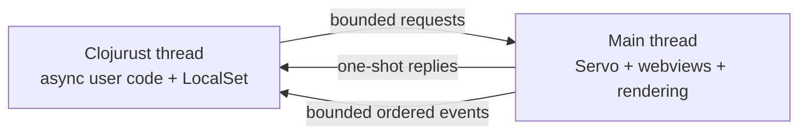

# Separate engine and async runtime threads

Status: Phase 0 investigation, 2026-10-27. E7 implements the mechanism as an experiment.
The product crates still contain the original bootstrap.

## Ownership and user code

The main thread owns Servo, its webviews, and its rendering context.
The dedicated Clojurust thread owns its runtime, GC values, Tokio executor, and LocalSet.
The LocalSet runs continuously. It does not depend on frame callbacks or one-millisecond host slices.
Only owned Rust messages cross the boundary.



Native browser calls return Clojurust futures immediately.
An `^:async` function awaits those futures.
The native bridge copies arguments into Rust messages before submission.
It converts reply data into GC values only on the Clojurust thread.
No `Value`, `Env`, `WebView`, or rendering context crosses threads.

The [user example](../experiments/e7-async-bridge/user.cljrs) contains the full async workflow and its assertions.
Its browser helpers have this shape:

```clojure
(defn ^:async create! [url]
  (result! (await (native/request "create" 0 url))))

(defn ^:async eval-js! [view script]
  (result! (await (native/request "eval-js" view script))))
```

The `result!` helper unwraps successful replies or throws their structured errors.
The example awaits lifecycle events and script results while a Clojure heartbeat task advances.
Normal computation can remain synchronous. Operations that wait use `await` inside async entry points.

This API does not enforce a sandbox for arbitrary user code.
A blocking native call or infinite synchronous loop can still stop the Clojurust thread.
Servo continues independently, but commands and hooks on that runtime stop until it recovers.

## Channel contract in E7

| Concern | Probe behavior |
|---|---|
| Request transport | Tokio MPSC queue with two slots. Submission awaits available space. |
| Outstanding work | Eight permits cover queued and active requests. Further calls resolve to `:busy`. |
| Replies | Each request has a monotonic identifier and a separate one-shot reply channel. Completion order can differ from submission order. |
| Response shape | `{:request/id n :ok true :value x}` or `{:request/id n :ok false :error :reason}`. |
| Events | Two-slot queue with monotonic sequence numbers. Clojure awaits the next event. |
| Event overload | The probe reports an error and stops. Servo delegates never block on the consumer. |
| Deadlines | Accepted requests have a five-second deadline, including queue wait. |
| Timeout before execution | The reply receiver closes. The engine skips a queued request whose receiver already closed. |
| Timeout after execution starts | The operation can still complete. A timeout does not undo a side effect. |
| Close | The engine invalidates the handle. It rejects later requests and settles pending evaluations for that handle. |
| Identifiers | Handle identifiers never repeat within the engine session. |
| Disconnect | Request futures resolve to `:engine-disconnected` or `:reply-dropped`. Event reads return `nil` after the queue drains. |
| Shutdown | The process runner imposes a deadline and kills a blocked child. Cooperative runtime cancellation alone cannot stop every blocking call. |

The engine processes at most four requests before each Servo turn.
The headless driver waits for channel or Servo wakeups, with a one-millisecond fallback.
A native shell will use `EventLoopProxy` instead of this headless wait.

The mock backend completes each batch in reverse order.
The Clojure assertions require every reply to match its original request.
Unit tests cover transport types, event overload, disconnect, dropped replies, queued timeouts, and invalidation of pending evaluations.
The host also collects garbage after it roots the entry future, before the program runs.

This contract bounds request counts, not message sizes or the number of arbitrary user tasks.
Product behavior still needs payload limits and an event overload policy.
State events can permit coalescing. Lifecycle and permission events need explicit delivery or failure semantics.

## Results

Measurements used macOS 26.5.2 arm64, Rust 1.97.1, Servo 0.7.0, and the pinned Clojurust revision.
The Servo probe uses `SoftwareRenderingContext` and a local `data:` page.
It does not depend on network pages or native UI automation.

| Probe | Result |
|---|---|
| Pure async user workflow, mock | Passed create, ordered events, concurrent replies, overload, close, and stale-handle assertions. |
| Pure async user workflow, Servo | Passed the same assertions against real webviews and JavaScript evaluation. |
| Servo transport sample | 119 accepted requests, median 62.5 microseconds, maximum 45.647 ms. |
| Deliberate 200 ms runtime block | Servo completed 57 loop turns and painted six frames. The page timer also advanced. |
| Idle async timer | Final mock process: 1.089 s elapsed, 1.028 CPU-seconds for a one-second wait. |
| Await under keyword lookup | The bounded reproducer entered its async function, then blocked until the parent killed it. |

The transport sample mixes create, script, close, error, and instrumentation requests.
Its duration starts inside the native future and ends at reply receipt.
It excludes later Clojure processing and is not an end-to-end DOM latency measurement.
Six painted frames during a stall do not establish display frame rate or a 60 Hz guarantee.
The run also emitted the GL texture warning seen in E3.
The Clojurust host uses Tiered mode with the pinned async evaluator.
This result does not cover a JIT or AOT backend.

## Pinned upstream limits

The [async gap register](clojurust-async-gaps.md) is the canonical specification for upstream fixes and regression coverage.
The owner requires upstream fixes. The binding workaround below remains temporary probe code.

### Idle waits repeatedly poll

`cljrs_async::await_value` checks a future state and calls `tokio::task::yield_now` until that future settles.
Its promise path does the same.
The bridge's Rust future awaits Tokio channels, but the surrounding Clojurust wait remains runnable.
This explains the CPU use during the idle timer probe.

An upstream change needs notification-based waits for futures and promises.
It must cover completion, failure, cancellation, lost wakeups, and GC roots across suspension.
The bridge does not alter the upstream implementation or claim that idle waits park efficiently.

### Some async expressions enter the synchronous evaluator

The pinned async evaluator delegates calls with a non-symbol head to synchronous evaluation.
This form therefore blocks its LocalSet:

```clojure
(:value (await pending))
```

The working example binds the result before lookup:

```clojure
(let [reply (await pending)]
  (:value reply))
```

Synchronous top-level `await` has the same scheduling risk for futures that need this LocalSet.
Form-intercepted calls also need an audit before arbitrary async user code can be supported.
An upstream fix needs async evaluation of the callee expression and arguments, plus regression tests.

## Reproduction

For the portable mock workflow, run:

```sh
cargo build --locked -p bulwark-experiment-e7
python3 experiments/run_e7.py
python3 experiments/run_e7.py --idle
python3 experiments/run_e7.py --probe-keyword-await
```

The last command is a diagnostic. A reported block confirms a limitation, not a passing async feature.
The runner terminates the child after three seconds.

For real Servo, run:

```sh
cargo build --locked -p bulwark-experiment-e7 --features servo
python3 experiments/run_e7.py --servo
```

The normal runner also imposes a process deadline.
The Rust loop's cooperative deadline cannot stop an interpreter thread blocked inside a native wait.

## Next decisions

E7 supports continued development of the separate-thread design.
D1 remains provisional until the required upstream async fixes and product queue policies are complete.
Next work includes a native `winit` wakeup path, async command dispatch, nREPL integration on the runtime thread, and shutdown under failure.
E3 input observation, E4's DOM channel, and E5's layout experiment remain separate requirements.
